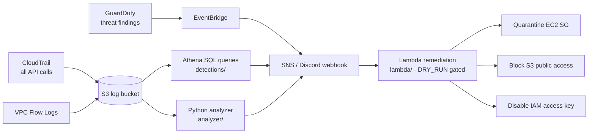

# ☁️ AWS Cloud Detection & Incident Response

**Control-plane security for AWS:** CloudTrail detections, GuardDuty triage, IaC misconfiguration scanning, and incident-response runbooks with safe auto-remediation.

> Portfolio project by **Gilberto A. Cedillo Soto (Abisaíd)** — B.S. Cybersecurity, BYU–Idaho (Class of 2027) · [github.com/gilbertocedillo](https://github.com/gilbertocedillo)
> Companion to [aws-n8n-soc-automation](https://github.com/gilbertocedillo/aws-n8n-soc-automation): that project monitors **inside the EC2 host**; this one monitors the **AWS control plane** — the API calls that create, expose, and steal cloud resources.

`AWS CloudTrail` · `GuardDuty` · `Athena SQL` · `EventBridge` · `Python` · `Terraform` · `Checkov` · `MITRE ATT&CK for Cloud` · `Lambda`

---

## Architecture



```
Attacker / mistake --API call--> CloudTrail record --> S3
                                     |-> Athena scheduled queries (this repo)
                                     |-> analyze_cloudtrail.py (same rules, offline/CI)
GuardDuty finding -------------------> EventBridge --> SNS/Discord --> triage runbook
High-confidence + approved ----------> Lambda remediation (quarantine / block / disable key)
```

## Detection catalog

| ID | Detection | Source | ATT&CK (Cloud) | Severity |
|---|---|---|---|---|
| DET-01 | Console sign-in without MFA | CloudTrail `ConsoleLogin` | T1078 Valid Accounts | High |
| DET-02 | Root account usage | CloudTrail `userIdentity.type = Root` | T1078.004 Cloud Accounts | Critical |
| DET-03 | IAM policy change / `CreateUser` / `AttachUserPolicy` | CloudTrail IAM events | T1098 Account Manipulation, T1136.003 Cloud Account | High |
| DET-04 | Security Group opened to `0.0.0.0/0` | CloudTrail `AuthorizeSecurityGroupIngress` | T1021 / T1190 exposure | High |
| DET-05 | S3 bucket policy made public | CloudTrail `PutBucketPolicy` / `PutBucketAcl` | T1537 / data exposure | Critical |
| DET-06 | `RunInstances` in unusual region / large burst | CloudTrail EC2 | T1578 Modify Cloud Compute, crypto-mining precursor | Medium |
| DET-07 | CloudTrail tampering: `StopLogging` / `DeleteTrail` / `PutEventSelectors` | CloudTrail | T1562.008 Impair Defenses | Critical |
| DET-08 | GuardDuty `CryptoCurrency:EC2/BitcoinTool.B!DNS` etc. | GuardDuty | T1496 Resource Hijacking | Critical |

Queries: [`detections/athena-queries.sql`](detections/athena-queries.sql) · Same rules offline: [`analyzer/analyze_cloudtrail.py`](analyzer/analyze_cloudtrail.py)

## IaC scanning — vulnerable vs. secure, side by side

`terraform-vulnerable/` and `terraform-secure/` are the **same stack** in two states. Every misconfiguration/fix pair is numbered so you can diff them:

| ID | Misconfiguration | Fix |
|---|---|---|
| SEC-01 | Public S3 (`public-read` ACL, no Block Public Access) | Private bucket + Block Public Access + bucket policy |
| SEC-02 | Security Group SSH `0.0.0.0/0` | SSH scoped to operator `/32` (or SSM only) |
| SEC-03 | Unencrypted EBS / storage | `encrypted = true` (KMS) everywhere |
| SEC-04 | IAM wildcard `Action: *`, `Resource: *` | Least-privilege scoped policy |
| SEC-05 | No CloudTrail, no GuardDuty | Multi-region trail to S3 + GuardDuty detector |

```bash
pip install checkov   # the real tool
checkov -d terraform-vulnerable/    # expect failures on SEC-01..05 patterns
checkov -d terraform-secure/        # expect pass
python3 scanner/scan_terraform.py terraform-vulnerable/   # this repo's mini-scanner (JSON findings)
python3 scanner/scan_terraform.py terraform-secure/       # expect []
```

The custom scanner is a learning/teaching tool — see [`scanner/README.md`](scanner/README.md) for an honest comparison with Checkov.

## Analyzer quick start

```bash
python3 analyzer/analyze_cloudtrail.py sample-logs/sample-cloudtrail.json
# -> alerts printed + written to alerts.json: the 5 planted malicious events, benign noise ignored
ALERT_WEBHOOK_URL=https://discord.com/api/webhooks/... \
  python3 analyzer/analyze_cloudtrail.py sample-logs/sample-cloudtrail.json
```

## Auto-remediation (safety-gated)

[`lambda/remediate.py`](lambda/remediate.py) dispatches by `action`:
`quarantine_ec2` · `block_s3_public` · `disable_access_key`. Every action is
**idempotent**, logs structured JSON, and respects `DRY_RUN=true` (the default) —
in a real account, high-impact actions should sit behind a human approval step
(SNS → approve → invoke). See the runbooks:

- [`runbooks/ir-compromised-iam-key.md`](runbooks/ir-compromised-iam-key.md)
- [`runbooks/ir-public-s3-bucket.md`](runbooks/ir-public-s3-bucket.md)
- [`runbooks/ir-ec2-crypto-mining.md`](runbooks/ir-ec2-crypto-mining.md)

## Tests

```bash
python3 tests/test_analyzer_scanner.py   # built-in runner (or: pytest tests/)
# analyzer detects the 5 planted events, ignores benign ones; scanner flags
# the vulnerable stack and passes the secure stack
```

## Cost notes (free-tier friendly)

CloudTrail: first trail is free (management events). Athena: $5/TB scanned —
partition by date and these queries cost cents. GuardDuty: 30-day free trial,
then per-event pricing — enable it in a lab account and set a billing alarm.
S3 log storage: lifecycle-expire at 90 days. **Always set an AWS Budgets alert before experimenting.**

## Honest scope

Built and validated locally against synthetic logs and the bundled Terraform;
not yet run against a live AWS account. Designed/directed by the author with
AI-assisted implementation, reviewed and tested — see
[`docs/interview-defense-guide.md`](docs/interview-defense-guide.md).

## Roadmap
- [ ] EventBridge real-time versions of DET-01..07 (Athena is batch; know the tradeoff)
- [ ] GuardDuty → n8n/Discord formatter (reuse the SOC automation webhook)
- [ ] Athena partition automation + scheduled query results to S3

## License
MIT © 2026 Gilberto A. Cedillo Soto
